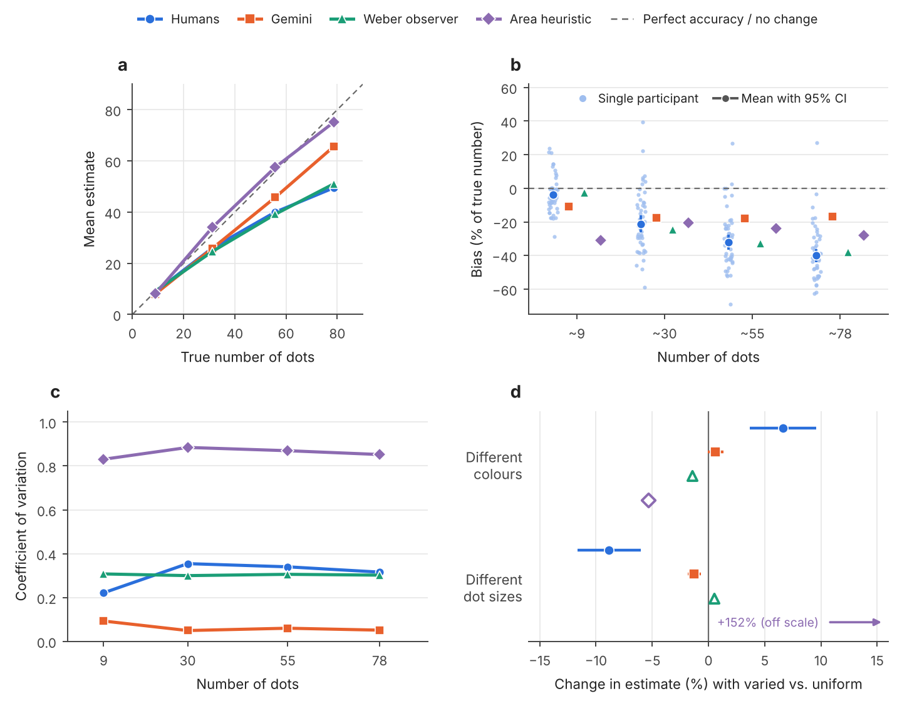
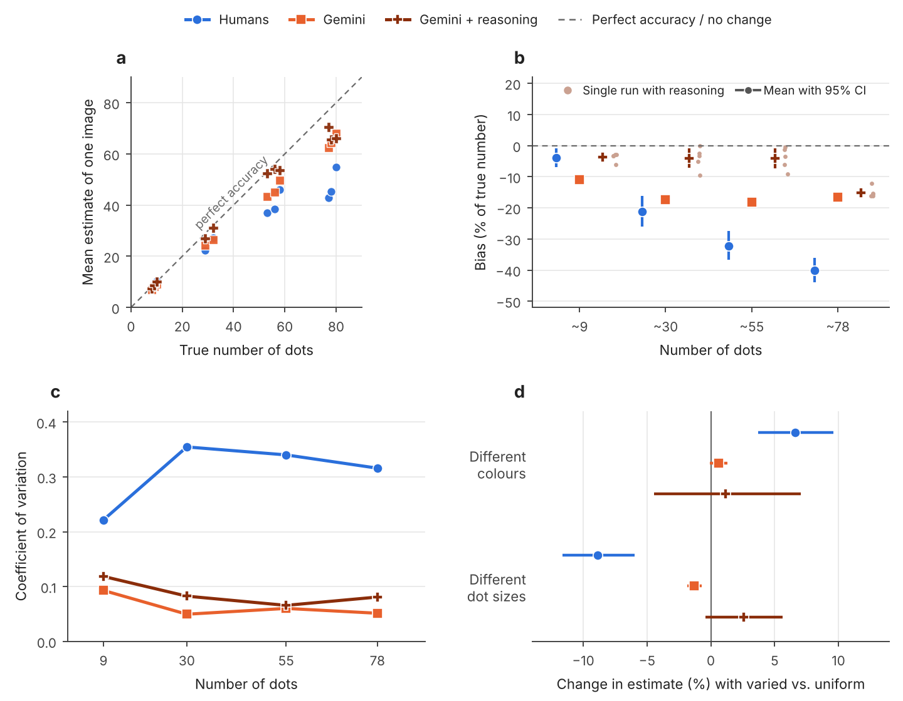

# Counting dots: humans vs. AI

How many dots are on the screen? People can't count them in half a second, so they guess. This project compares how humans and AI models guess, and checks whether colour and dot size change the guess in the same way.

The test can be completed [here](https://inessdav.github.io/numerosity-human-vs-vlm/).

## Question

Do AI models estimate numbers the same way as people? Two things are changed in the images:

- **Colour.** Dots are either all one colour, or different colours.
- **Dot size.** Dots are either all the same size, or different sizes.

**H1:** Different colours make people slower, but do not change how accurate they are.
**H2:** Larger dots lead to higher estimates.

## How it works

There are 16 images: colour (same / different) × dot size (same / different) × 4 numbers of dots (about 9, 30, 55 and 78). Every person and every AI run sees all 16 images, in random order.

- **People** see a cross for 0.5 s, then an image for 0.5 s, then type how many dots they saw.
- **AI** gets each image in a separate request with the question "How many dots do you see?" and answers with one number. One run of 16 images counts as one virtual participant.
- **Simple models** are two computer simulations that guess without looking at the image: one follows Weber's law (the bigger the number, the bigger the error), the other guesses from the total area of the dots.

## Results

50 people (800 answers), 20 runs of Gemini (320 answers) and 5 runs of Gemini with reasoning (80 answers) saw the same 16 images.

**In short:** the more dots there are, the more people underestimate them. Gemini misses a nearly constant share and gives almost the same answer every time. Colour and dot size barely move Gemini, while people react slightly to both. Neither follows the total ink area, so both respond to the number of dots, not to how full the picture looks.



| | Humans | Gemini | Gemini + reasoning |
|---|---:|---:|---:|
| Participants or runs | 50 | 20 | 5 |
| Mean answer, % of true number | 79 | 84 | 93 |
| Bias at about 9 dots | −4 % | −11 % | −4 % |
| Bias at about 78 dots | −40 % | −17 % | −15 % |
| Spread of answers (CV) | 0.30 | 0.03 | 0.06 |
| Colour effect | +6.6 % | +0.6 % | +1.1 % |
| Dot size effect | −8.8 % | −1.3 % | +2.6 % |

Colour and size effects are the change of the estimate for varied vs. uniform images. With only 5 runs, the effects of Gemini with reasoning cannot be told apart from zero.

- **H1** holds for accuracy: different colours did not change it, and people were not slower.
- **H2** is not supported: larger dots did not raise the estimates. In people they lowered them slightly.
- **Reasoning** removes most of Gemini's underestimation up to about 55 dots, but not at about 78 dots.



## What's in this repository

```
docs/      the experiment (runs in a browser) and the 16 images
stimuli/   exact position and size of every dot
figures/   summary figures
ai/        scripts that ask the AI and run the simple models
data/      collected answers (humans, AI, simple models)
analysis/  analysis plan
```

## Run it yourself

```bash
pip install -r requirements.txt
cd ai
export GEMINI_API_KEY=...
python run_models.py --provider openai --model gemini-3.1-flash-lite \
  --base-url https://generativelanguage.googleapis.com/v1beta/openai/ \
  --api-key-env GEMINI_API_KEY --runs 20 --out ../data/results_gemini.csv
# same model with reasoning switched on (thinking tokens count towards --max-tokens)
python run_models.py --provider openai --model gemini-3.1-flash-lite \
  --base-url https://generativelanguage.googleapis.com/v1beta/openai/ \
  --api-key-env GEMINI_API_KEY --runs 5 --reasoning-effort high --max-tokens 4096 \
  --out ../data/results_gemini_reasoning.csv
python baselines.py --runs 20 --out ../data/results_baselines.csv
```

Next to every AI result file, a `.meta.json` file stores the model, settings and date.
